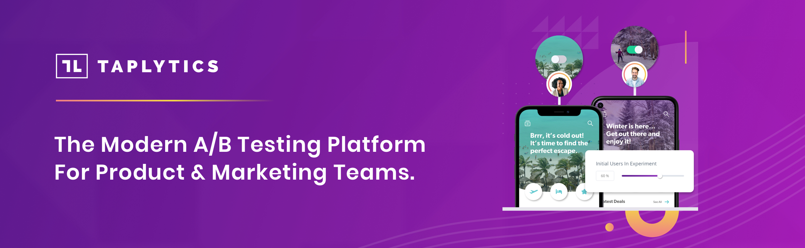

 
**Taplytics is now DevCycle!**
Built from the ground up to make experimentation easy, scalable and data-driven.
---

## ⚠️ Taplytics No Longer Available
**The Taplytics platform has been completely decommissioned and is no longer operational. All Taplytics services, APIs, and dashboards have been permanently shut down.**

**For more information - please visit [devcycle.com/taplytics](https://devcycle.com/taplytics)**

### 🚀 DevCycle is the Complete Replacement

DevCycle is the full successor to Taplytics, providing all feature flagging and experimentation capabilities with significant improvements:

- **Experiment on Any Feature and Choose Winners Faster**: DevCycle makes it easy to put any feature behind a flag and run an experiment on it across all platforms, environments and connected devices.
- **Enhanced Performance**: Faster flag evaluations and reduced latency 
- **Run Experiments Anywhere**:
   * Multiple Testing Types: DevCycle supports a/b testing, multivariate testing, user experience and conversion funnel tests. Engineers can also run server-side, algorithm, architecture and database query tests.
   * Beta Opt-in Programs: Run qualitative testing through DevCycle's beta opt-in programs, allowing a select audience to try new features before they're widely released.
- **Modern Architecture**: Built for scale with enterprise-grade reliability

### Get Started with DevCycle Today

* **[Sign up for DevCycle](https://app.devcycle.com)** - Start your free account today
* **[DevCycle Documentation](https://docs.devcycle.com/)** - Full platform documentation

---